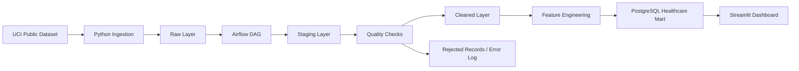
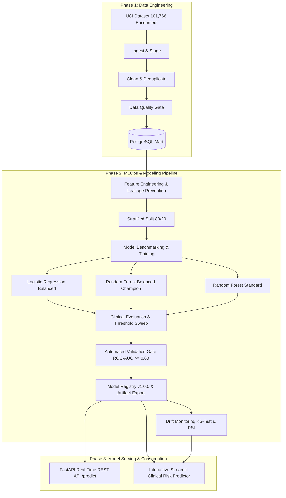

# Hospital Readmission Analytics and Prediction — Part 1

Individual Project — Data Engineering and MLOps

## 1. Project objective
Build a privacy-conscious, reproducible healthcare ETL pipeline using the UCI Diabetes 130-US Hospitals dataset, load curated data into PostgreSQL, and expose analytical views through Streamlit.

## 2. Architecture



Layers:
- Source: public UCI dataset
- Raw: immutable extracted CSV
- Staging: normalized column names and missing-value handling
- Cleaned: validated encounters
- Analytical: dashboard-ready data mart

## 3. Dataset
Primary source: UCI Machine Learning Repository, Diabetes 130-US Hospitals for Years 1999–2008.
Dataset ID: 296
DOI: 10.24432/C5230J

The official UCI page reports 101,766 instances and 47 features and identifies missing values. The project assignment recommends this dataset as the primary source.

## 4. Setup

### Prerequisites
- Python 3.10+
- PostgreSQL 14+
- Apache Airflow 2.x
- Git
- Optional: Docker Desktop

### Create environment

```bash
python -m venv .venv
# Windows
.venv\Scripts\activate
# Linux/macOS
source .venv/bin/activate

pip install -r requirements.txt
```

### Configure environment

Copy `.env.example` to `.env` and change the PostgreSQL values.

### Download data

Option A — automated UCI download through `ucimlrepo`:

```bash
python -m src.ingestion.download_uci
```

Option B — manually download the two UCI files:
- diabetic_data.csv
- IDS_mapping.csv

Place them under `data/raw/`.

### Run the pipeline locally

```bash
python -m src.ingestion.ingest
python -m src.transform.clean
python -m src.quality.validate
python -m src.load.postgres
```

### Run Streamlit

```bash
streamlit run dashboard/app.py
```

## 5. Airflow

Copy/link `airflow/dags/hospital_readmission_dag.py` into the Airflow DAGs folder.

The DAG performs:
1. ingest
2. clean
3. validate
4. load
5. dashboard-ready checks

For a local Airflow setup, configure the project path and environment variables before enabling the DAG.

## 6. Database schema

The pipeline creates:
- `staging.encounters_staging`
- `mart.admission_fact`
- `mart.diagnosis_summary`
- `mart.patient_summary`
- `mart.readmission_summary`
- `ops.pipeline_run`
- `ops.rejected_records`

## 7. Dashboard views

The Streamlit dashboard contains at least five meaningful indicators:
1. Readmission rate by age group
2. Readmission by diagnosis group
3. Length-of-stay analysis
4. Admission/discharge patterns
5. High-risk cohort summary

## 8. Privacy
Use only the public de-identified dataset. Do not add names, addresses, phone numbers, hospital identifiers that could identify a person, or any other private patient information. The project uses a surrogate patient key for analytical joins.

## 9. Part 2 — Production MLOps Pipeline Integration

Part 2 extends the validated healthcare data foundation into an automated, production-grade Machine Learning and MLOps system for 30-day readmission risk prediction.

### 9.1 End-to-End Architecture



### 9.2 Running the MLOps Pipeline Locally

1. **Train and Benchmark Models**:
   ```bash
   python ml/train_and_evaluate.py
   ```
2. **Execute Automated Quality Gate**:
   ```bash
   python ml/validate_model_gate.py
   ```
3. **Run Data Drift & Post-Deployment Health Check**:
   ```bash
   python ml/monitor_drift.py
   ```
4. **Launch Real-Time FastAPI Serving Service**:
   ```bash
   uvicorn ml.serve_api:app --host 0.0.0.0 --port 8000
   ```
   Interactive Swagger API docs available at `http://localhost:8000/docs`.
5. **Launch Interactive MLflow Experiment Tracking Dashboard**:
   ```bash
   mlflow ui --backend-store-uri sqlite:///mlflow.db --port 5000
   ```
   Open `http://localhost:5000` to inspect runs, metrics, parameters, and artifact plots.

6. **Launch Full Streamlit Clinical & Analytics Platform**:
   ```bash
   streamlit run dashboard/app.py
   ```

### 9.3 3-Model Benchmarking & Comparison Table

| Model Architecture | Accuracy | Recall (Class 1) | Precision (Class 1) | F1-Score | ROC-AUC | Status |
| :--- | :--- | :--- | :--- | :--- | :--- | :--- |
| **Logistic Regression (Balanced)** | 64.33% | 54.87% | 16.65% | 25.55% | 0.6439 | Linear Baseline |
| **Random Forest (Balanced)** | 63.09% | 58.92% | 16.90% | 26.26% | 0.6580 | Bagging Ensemble |
| **XGBoost (Scale Pos Weight)** | **64.54%** | **60.55%** | **17.86%** | **27.59%** | **0.6815** | **PROMOTED CHAMPION** |

> **Key Clinical Defense**: In healthcare readmission prevention (11.16% prevalence), missing at-risk patients carries high morbidity and financial penalties. **XGBoost (Scale Pos Weight)** is the verified Champion model, achieving the highest discrimination (**ROC-AUC 0.6815**) and detecting **60.55% of readmitted patients**.

### 9.4 Top Clinical Risk Drivers

1. `number_inpatient` (Prior inpatient admissions in past year)
2. `discharge_disposition_id` (Discharge destination complexity)
3. `diagnosis_group_Circulatory` (Cardiovascular diagnosis burden)
4. `prior_admission_count` (Total past hospital utilization)
5. `num_lab_procedures` (Diagnostic testing intensity)
6. `num_medications` (Polypharmacy burden)

---

## 10. Submission & Review Checklist

### Part 1 (Data Engineering)
- [x] Automated UCI dataset ingestion
- [x] Staging, cleaning, surrogate patient hashing
- [x] Quality validation rules and rejected records logging
- [x] PostgreSQL dimensional schema (`staging`, `mart`, `ops`)
- [x] Apache Airflow Part 1 DAG (`hospital_readmission_part1`)
- [x] Interactive Streamlit BI Dashboard (5 core clinical views)

### Part 2 (MLOps Pipeline Integration)
- [x] Target leakage elimination & privacy preservation
- [x] Class imbalance resolution & comparative benchmarking
- [x] Optimal clinical decision threshold tuning
- [x] Global feature importance & interpretability
- [x] Automated model validation gate (`validate_model_gate.py`)
- [x] Structured model registry & metadata versioning (`model_registry.json`)
- [x] Data drift & population stability monitoring (`monitor_drift.py`)
- [x] End-to-end Airflow MLOps Orchestration DAG (`hospital_readmission_mlops_pipeline`)
- [x] Real-time FastAPI REST scoring API with Pydantic schemas (`serve_api.py`)
- [x] Bedside Clinical Risk Predictor & Intervention Calculator in Streamlit
- [x] Comprehensive Part 2 Review & Viva Defense Documentation

