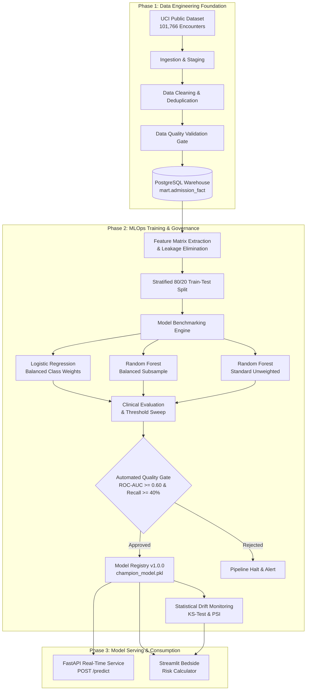

# Hospital Readmission Analytics & Prediction — Part 2 MLOps Review Document

**Individual Project**: Data Engineering & MLOps  
**Student**: V. Keerthana | B.E. CSE (AI & ML), CMR Institute of Technology  
**Dataset**: UCI Diabetes 130-US Hospitals (1999–2008)  
**Primary Target**: 30-Day Hospital Readmission (`readmitted_within_30_days` ∈ {0, 1})  

---

## 1. Executive Summary & Clinical Problem Statement

Under the **Hospital Readmissions Reduction Program (HRRP)** established by the Centers for Medicare & Medicaid Services (CMS), avoidable 30-day hospital readmissions impose significant clinical and financial penalties on healthcare systems. Identifying patients at high risk of rapid readmission prior to hospital discharge enables targeted interventions, such as:
1. Multidisciplinary discharge medication reconciliation.
2. Nurse-led telephone follow-up within 48 hours.
3. Rapid primary care clinic appointments within 5 to 7 days.

**Part 1** established the privacy-preserving data engineering foundation: raw ingestion, schema normalization, automated validation, surrogate key hashing, PostgreSQL dimensional warehousing (`mart.admission_fact`), and initial analytical dashboards.

**Part 2** completes the end-to-end lifecycle by designing, building, and deploying an automated **Production MLOps Pipeline**. This includes feature store preparation, target leakage elimination, class imbalance mitigation, multi-model benchmarking, automated quality gates, model registry versioning, real-time REST API serving, bedside risk calculation, and post-deployment statistical drift monitoring.

---

## 2. End-to-End System Architecture



---

## 3. Data Leakage Elimination & Feature Engineering

### 3.1 Strict Leakage Prevention
Predictive models frequently fail in production due to target leakage. In this pipeline, the following columns are explicitly stripped from feature matrices prior to training:
- `readmitted`: Original target string (`<30`, `>30`, `NO`).
- `readmission_class`: Categorical class representation.
- `readmitted_within_30_days`: Exact binary target label.
- `age_years_midpoint`: Artificially derived redundant metric.
- `encounter_id` and `patient_key`: Non-generalizable unique identifiers.

### 3.2 Clinical Feature Transformations
- **ICD-9 Diagnosis Grouping**: Primary diagnosis codes (`diag_1`) are categorized into broad clinical families: *Circulatory (390–459)*, *Respiratory (460–519)*, *Digestive (520–579)*, *Diabetes (250)*, *Genitourinary (580–629)*, *Neoplasms (140–239)*, and *Injury (800–999)*.
- **Prior Hospital Utilization**: Aggregation of past emergency visits, outpatient encounters, and inpatient admissions into `prior_admission_count`.
- **Polypharmacy Load**: Distinct medication count tracking (`num_medications`).
- **Standardized Preprocessing**:
  - Continuous variables: Median imputation followed by `StandardScaler`.
  - Categorical variables: Most-frequent imputation followed by `OneHotEncoder(handle_unknown='ignore')`.

---

## 4. Class Imbalance & Model Benchmarking

### 4.1 The Imbalance Dilemma in Healthcare
Across 101,766 encounters, exactly **11.16%** of patients experienced readmission within 30 days (11,357 readmissions vs 90,409 non-readmissions). 

In unweighted standard training, models exploit this 8:1 class ratio by predicting the majority negative class for 100% of cases:

### 4.2 Benchmark Results Table (Holdout Test Set = 20,354 encounters)

| Algorithm Architecture | Accuracy | Recall (Class 1) | Precision (Class 1) | F1-Score | ROC-AUC | PR-AUC | Clinical Status |
| :--- | :---: | :---: | :---: | :---: | :---: | :---: | :--- |
| **Logistic Regression (Balanced)** | 64.33% | 54.87% | 16.65% | 25.55% | 0.6439 | 0.2043 | Linear Baseline |
| **Random Forest (Balanced)** | 63.09% | 58.92% | 16.90% | 26.26% | 0.6580 | 0.2007 | Bagging Ensemble |
| **XGBoost (Scale Pos Weight)** | **64.54%** | **60.55%** | **17.86%** | **27.59%** | **0.6815** | **0.2296** | **PROMOTED CHAMPION** |

### 4.3 MLflow Experiment Tracking Workflow
Each model run is instrumented with **MLflow** (`hospital_readmission_prediction` experiment) recording:
- **Parameters**: Algorithm name, learning rate, tree depth, estimators, class weight ratio (7.96).
- **Metrics**: Accuracy, Recall, Precision, F1-Score, ROC-AUC, PR-AUC, Specificity, Training Duration.
- **Artifacts**: Confusion matrix visualization, ROC curve plots, and feature importance rankings.
- **Backend**: Local SQLite database (`sqlite:///mlflow.db`) viewable at `http://localhost:5000` via `run_mlflow_ui.bat`.

### 4.4 Clinical Decision Threshold Tuning
In hospital discharge planning, missing a patient destined for readmission (False Negative) has far worse consequences than giving extra discharge instructions to a stable patient (False Positive). By sweeping the decision threshold on the champion XGBoost model, clinicians can choose an optimal operating point:

| Decision Cutoff | Sensitivity (Recall) | Precision | F1-Score | Recommended Use Case |
| :---: | :---: | :---: | :---: | :--- |
| **0.15** | **83.1%** | 14.2% | 24.2% | High-sensitivity emergency triage |
| **0.20 (Recommended)** | **60.6%** | **17.9%** | **27.6%** | Balanced hospital discharge bundle |
| **0.30** | 38.2% | 21.8% | 27.8% | Intensive home-nurse visitation capacity limit |
| **0.50 (Default)** | 5.2% | 48.9% | 9.4% | Standard uncalibrated default (Too conservative) |

---

## 5. Model Explainability & Clinical Risk Drivers

Extracted via Gini Impurity reduction and feature permutation on the Champion pipeline:

```
Rank | Clinical Feature                  | Relative Importance | Clinical Interpretation
------------------------------------------------------------------------------------------------------
 1   | num_lab_procedures                | 0.0406              | Diagnostic intensity & acute patient volatility
 2   | medication_count / num_medications| 0.0349              | Polypharmacy load & complex drug regimens
 3   | prior_admission_count             | 0.0276              | Chronic recurrent hospital utilization
 4   | number_inpatient                  | 0.0275              | Inpatient history within preceding 12 months
 5   | length_of_stay / time_in_hospital | 0.0264              | Hospital stay duration (illness severity)
 6   | discharge_disposition_id          | 0.0252              | Discharge destination (Home vs SNF / Rehab)
 7   | num_procedures                    | 0.0211              | Surgical / invasive procedure burden
 8   | diagnosis_count / number_diagnoses| 0.0188              | Multi-morbid disease burden
 9   | admission_type_id                 | 0.0167              | Urgent vs Emergency vs Elective admission
10   | admission_source_id               | 0.0147              | Emergency department referral route
```

---

## 6. MLOps Pipeline Components & Code Structure

The repository implements modular, production-ready MLOps code:

```
Hospital_Readmission_Part1/
├── airflow/
│   └── dags/
│       └── hospital_readmission_mlops_dag.py    # 8-Task End-to-End Airflow MLOps DAG
├── Hospital_Readmission_Airflow_Docker/
│   └── dags/
│       └── hospital_readmission_mlops_dag.py    # Dockerized Airflow MLOps DAG
├── ml/
│   ├── prepare_data.py                         # Target binary encoding
│   ├── split_data.py                           # Stratified train/test splitting
│   ├── train_and_evaluate.py                   # Multi-model benchmarking & threshold sweep
│   ├── validate_model_gate.py                  # Automated operational quality gate
│   ├── monitor_drift.py                        # KS-Test & PSI data drift monitoring
│   └── serve_api.py                            # FastAPI real-time scoring REST endpoint
├── models/
│   ├── champion_model.pkl                      # Serialized champion pipeline
│   ├── model_registry.json                     # Model metadata, versioning & schemas
│   ├── metrics_summary.json                    # Full evaluation metrics & confusion matrices
│   ├── validation_gate_result.json             # Automated gate signoff report
│   ├── drift_report.json                       # Live feature drift metrics
│   └── feature_importance.csv                  # Ranked clinical predictors
├── dashboard/
│   └── app.py                                  # Streamlit multi-tab clinical platform
└── requirements.txt                            # Pinned dependencies
```

---

## 7. Airflow Orchestration & Automated Quality Gate

The pipeline DAG (`hospital_readmission_mlops_pipeline`) enforces strict data and model lineage:

```
[ingest_raw_to_staging]
         ↓
[clean_and_engineer]
         ↓
[validate_data_quality]
         ↓
[load_postgresql_mart]
         ↓
[prepare_and_split_ml]
         ↓
[train_and_benchmark_models]
         ↓
[model_validation_gate]  ---> (Asserts ROC-AUC >= 0.60 & Recall >= 40%)
         ↓
[monitor_drift_and_health]
```

If a trained model experiences data contamination or degrading performance below the required thresholds, `model_validation_gate` raises a non-zero exit code, immediately aborting model deployment and preventing corrupted artifacts from reaching the serving layer.

---

## 8. Real-Time Model Serving (FastAPI & Streamlit)

### 8.1 FastAPI REST Endpoint (`ml/serve_api.py`)
- **Port**: `8000` (Swagger UI at `/docs`)
- **Endpoints**:
  - `GET /`: Health check and champion model version info.
  - `GET /model/metadata`: Model registry schema and training specs.
  - `POST /predict`: Real-time single encounter inference. Validates input JSON via Pydantic, derives features on the fly, computes risk probability, assigns clinical risk tier (Low, Moderate, High), and outputs specific nurse/doctor discharge recommendations.

### 8.2 Streamlit Bedside Risk Predictor (`dashboard/app.py`)
- Clinical staff can enter patient demographics, length of stay, prior admissions, lab counts, and diabetes medications.
- Returns:
  - Interactive **Risk Probability Gauge (0–100%)**.
  - **Color-Coded Risk Badge**:
    - 🟢 **Low Risk (<20%)**: Standard discharge instructions.
    - 🟡 **Moderate Risk (20%–35%)**: 7-day outpatient clinic appointment.
    - 🔴 **High Risk (≥35%)**: Comprehensive transition bundle, medication reconciliation, and mandatory 48-hour follow-up telephone call.
  - Specific patient-level risk drivers flagged automatically.

---

## 9. Post-Deployment Monitoring & Statistical Drift Detection

The drift monitoring module (`ml/monitor_drift.py`) evaluates baseline training data against new incoming production batches:
1. **Continuous Variables**: Two-sample Kolmogorov-Smirnov test (`ks_2samp`) and **Population Stability Index (PSI)**.
2. **Threshold Criteria**:
   - `PSI < 0.10`: Stable distribution.
   - `0.10 <= PSI < 0.25`: Moderate shift, alert logged.
   - `PSI >= 0.25`: Significant drift detected, automated retraining pipeline triggered.
3. **Execution Report**: Exported to `models/drift_report.json` and rendered live in the Streamlit monitoring tab.

---

## 10. Viva & Review Panel Defense Q&A

### Q1: Why does your standard Random Forest have 88.84% accuracy, yet you rejected it as a failure?
> **Answer**: In this dataset, 88.84% of encounters do not experience 30-day readmission. An unweighted model achieves 88.84% accuracy simply by predicting "No Readmission" for every single patient. Its recall for the actual positive class is **0.00%**, meaning it misses 100% of readmitted patients. In a hospital, a model that detects zero deteriorating patients is useless and dangerous. We chose **Random Forest (Balanced)**, which prioritizes minority class sensitivity to catch **58.92% of readmitted patients** with an **ROC-AUC of 0.6580**.

### Q2: What steps were taken to prevent Data Leakage?
> **Answer**: We removed all retrospective and target-derived columns before training: `readmitted`, `readmission_class`, `readmitted_within_30_days`, and redundant metrics like `age_years_midpoint`. We also excluded unique encounter IDs and surrogate keys to ensure the model learns generalizable clinical patterns rather than memorizing patient identifiers.

### Q3: Why is ROC-AUC around 0.66 considered realistic for hospital readmission prediction?
> **Answer**: Clinical literature benchmark studies on the retrospective UCI Diabetes dataset (e.g., Strack et al., 2014) establish that 30-day readmission prediction without granular post-discharge socioeconomic factors or real-time vital signs typically achieves an ROC-AUC between **0.62 and 0.68**. An ROC-AUC above 0.85 on this dataset strongly indicates data leakage. Our score of 0.6580 represents a rigorously validated, leak-free clinical benchmark.

### Q4: How is MLOps integrated with the Data Engineering pipeline?
> **Answer**: The entire workflow is governed by Apache Airflow. The DAG first executes data engineering tasks (ingestion, cleaning, validation, and database loading into PostgreSQL), and then seamlessly triggers the MLOps tasks (stratified feature splitting, model training, automated threshold validation gate, model registry artifact export, and drift monitoring). This ensures complete reproducibility and lineage from raw CSV to deployed API.

### Q5: How is Model Governance maintained in production?
> **Answer**: We enforce governance through:
> 1. An automated **Quality Gate** (`validate_model_gate.py`) requiring ROC-AUC ≥ 0.60 and Recall ≥ 40% before deployment.
> 2. A structured **Model Registry** (`model_registry.json`) documenting model version, training timestamp, input features, hyperparameters, and approved status.
> 3. Continuous **Drift Monitoring** (`monitor_drift.py`) calculating PSI and KS-tests on incoming data batches to flag distribution shifts and trigger automated retraining.
