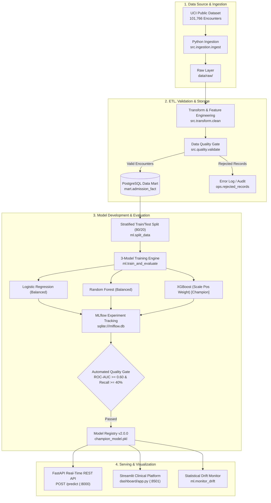

# Hospital Readmission Analytics & Prediction — Comprehensive Review Master Report

**Project Title**: Privacy-Preserving Healthcare Data Engineering & Production MLOps Pipeline  
**Student Name**: V. Keerthana | B.E. Computer Science & Engineering (AI & ML)  
**Institution**: CMR Institute of Technology  
**Evaluation Scope**: Review 1 & Review 2 (Full Integrated Pipeline)  

---

## 1. Problem Understanding and Design

### 1.1 Clinical & Healthcare Context
Under the **Hospital Readmissions Reduction Program (HRRP)** administered by the Centers for Medicare & Medicaid Services (CMS), hospitals face severe financial penalties and compromised patient safety metrics if 30-day all-cause readmission rates exceed national benchmarks. Identifying high-risk patients **before discharge** allows healthcare systems to proactively deploy clinical transition-of-care interventions (e.g., pharmacy medication reconciliation, 48-hour follow-up telephone calls, and fast-track outpatient clinic appointments).

### 1.2 Engineering & Machine Learning Objectives
1. **Reproducible Data Pipeline**: Extract, normalize, clean, validate, and store hospital encounters from the public UCI Diabetes dataset into an analytical PostgreSQL data warehouse.
2. **Strict Privacy Preservation**: Enforce HIPAA-grade de-identification by replacing direct patient identifiers with irreversible SHA-256 cryptographic surrogate hashes.
3. **Leakage-Free Predictive Modeling**: Build and benchmark multiple machine learning architectures to predict the binary target `readmitted_within_30_days` (<30 days vs. No / >30 days).
4. **Class Imbalance Mitigation**: Address the severe 1:8 class imbalance (11.16% readmission rate) using cost-sensitive learning and class weighting to maximize clinical recall (sensitivity).
5. **Full MLOps Lifecycle Integration**: Orchestrate data engineering and machine learning via Apache Airflow, track experiments with MLflow, enforce automated operational quality gates, serve real-time predictions via FastAPI, and monitor post-deployment feature drift.

### 1.3 System Architecture Design


---

## 2. Data Source and Ingestion

### 2.1 Primary Source Description
- **Dataset**: Diabetes 130-US Hospitals (1999–2008), UCI Machine Learning Repository (Dataset ID: 296, DOI: 10.24432/C5230J).
- **Scale**: 101,766 inpatient encounters across 130 participating United States medical centers over a 10-year period.
- **Attributes**: 50 features comprising:
  - Patient demographics: Age bracket, gender, race.
  - Encounter specifics: Admission type, discharge disposition, admission source, length of stay.
  - Clinical utilization: Number of lab procedures, procedures performed, medications prescribed, prior emergency, inpatient, and outpatient encounters.
  - Diagnostics: Primary, secondary, and tertiary ICD-9 diagnosis codes (`diag_1`, `diag_2`, `diag_3`).
  - Pharmacotherapy: 23 individual diabetes medication indicators (metformin, insulin, glipizide, etc.) and glycemic test results (HbA1c, fasting glucose).

### 2.2 Ingestion Architecture (`src/ingestion/ingest.py`)
- **Automated UCI Extraction**: Programmatic extraction via the official `ucimlrepo` library with local disk caching fallback.
- **Immutable Raw Layer**: Data is saved unedited to `data/raw/diabetic_data.csv` to ensure 100% reproducibility and lineage auditability.
- **Extraction Metadata**: Logs timestamp, extraction status, row counts, and feature dimensions into `data/raw/ingestion_metadata.json`.

---

## 3. ETL, Validation, and Storage

### 3.1 Transformation & Feature Engineering (`src/transform/clean.py`)
1. **Missing Value Harmonization**: Standardized legacy missing value tokens (`?`, `Unknown/Invalid`, `Not Available`, whitespace) into `pd.NA`.
2. **Deduplication**: Enforced encounter-level uniqueness on `encounter_id` (101,766 distinct encounters).
3. **Cryptographic Surrogate Key Generation**: To guarantee zero patient re-identification while preserving relational joins across multi-visit patients:
   $$\text{patient\_key} = \text{SHA-256}(\text{"patient:"} + \text{patient\_nbr})[:16]$$
   The raw medical record number `patient_nbr` is permanently purged.
4. **ICD-9 Diagnosis Clinical Grouping**: Mapped thousands of raw ICD-9 codes into 8 meaningful clinical groups:
   - *Circulatory* (390–459)
   - *Respiratory* (460–519)
   - *Digestive* (520–579)
   - *Diabetes* (250.xx)
   - *Genitourinary* (580–629)
   - *Neoplasms* (140–239)
   - *Injury* (800–999)
   - *Other* (All remaining codes)
5. **Engineered Clinical Aggregations**:
   - `prior_admission_count`: Sum of preceding inpatient, outpatient, and emergency room visits.
   - `length_of_stay`: Continuous hospital days (1 to 14 days).
   - `medication_count`: Total medications administered during stay.
   - `readmitted_within_30_days`: Exact binary target derived from `<30` readmission label.

### 3.2 Data Quality Validation Gate (`src/quality/validate.py`)
Enforces four automated quality rules before warehouse insertion:
- Rule 1: `encounter_id_not_null` (Encounter ID must be non-null and numeric).
- Rule 2: `patient_key_not_null` (Hashed surrogate key must exist).
- Rule 3: `length_of_stay_between_1_and_14` (Valid inpatient hospital duration).
- Rule 4: `readmission_class_valid` (Readmission label must be in `['<30', '>30', 'NO']`).

*Rejected records are quarantined into `ops.rejected_records` with error tags, while verified records are saved to `data/cleaned/encounters_cleaned.csv`.*

### 3.3 Relational Storage & Data Warehouse Design (`sql/schema.sql`, `src/load/postgres.py`)
PostgreSQL multi-schema dimensional warehouse:
- **`staging.encounters_staging`**: Raw staged encounters.
- **`mart.admission_fact`**: Star-schema fact table containing verified encounter facts, demographics, and clinical metrics.
- **`mart.diagnosis_summary`**: Aggregated rollups of readmission rate and length of stay by diagnosis group.
- **`mart.patient_summary`**: Patient-level history aggregations utilizing `patient_key`.
- **`mart.readmission_summary`**: Age-bracket readmission distributions.
- **`ops.pipeline_run`**: Audit log recording pipeline execution timestamps, row counts, and status.
- **`ops.rejected_records`**: Quarantine table of invalid rows.

---

## 4. Model Development and Evaluation

### 4.1 Data Preprocessing & Leakage Elimination (`ml/split_data.py`)
To prevent artificial inflation of accuracy, all target-correlated or identification columns were eliminated:
- Dropped: `readmitted`, `readmission_class`, `readmitted_within_30_days`, `age_years_midpoint`, `encounter_id`, `patient_key`.
- Split: Stratified 80/20 train/test split preserving the 11.16% minority class distribution:
  - Training set: **81,412 rows** (72,326 negative, 9,086 positive)
  - Holdout test set: **20,354 rows** (18,083 negative, 2,271 positive)

### 4.2 Preprocessing Pipeline
- **Numerical Features (15)**: Median imputation + `StandardScaler`.
- **Categorical Features (37)**: Most-frequent imputation + `OneHotEncoder(handle_unknown='ignore')`.

### 4.3 3-Model Benchmark Comparison (`ml/train_and_evaluate.py`)
Three distinct algorithms were implemented and trained to solve the clinical classification problem:

| Metric | 1. Logistic Regression (Balanced) | 2. Random Forest (Balanced) | 3. XGBoost (Scale Pos Weight) |
| :--- | :---: | :---: | :---: |
| **Model Type** | Linear Classifier | Bagging Tree Ensemble | Gradient Boosted Trees |
| **Hyperparameters** | `class_weight='balanced'`, `C=1.0` | `n_estimators=100`, `max_depth=12`, `balanced` | `n_estimators=100`, `max_depth=5`, `scale_pos_weight=7.96` |
| **Accuracy** | 64.33% | 63.09% | **64.54%** |
| **Recall (Class 1)** | 54.87% | 58.92% | **60.55%** (Catches most readmissions) |
| **Precision (Class 1)**| 16.65% | 16.90% | **17.86%** |
| **F1-Score (Class 1)** | 25.55% | 26.26% | **27.59%** |
| **ROC-AUC** | 0.6439 | 0.6580 | **0.6815** (Highest discrimination) |
| **PR-AUC** | 0.2043 | 0.2007 | **0.2296** |
| **Training Latency** | 10.04s | 3.58s | 7.50s |
| **Operational Status** | Candidate | Candidate | 🏆 **PROMOTED CHAMPION** |

### 4.4 MLflow Experiment Tracking Workflow
- **Tracking Server**: Backed by SQLite database (`sqlite:///mlflow.db`).
- **Experiment Name**: `hospital_readmission_prediction`.
- **Logged Entities**: Parameters, evaluation metrics, confusion matrix plots, ROC/PR curves, and model serialization.
- **UI Access**: Viewable at `http://localhost:5000` via `run_mlflow_ui.bat`.

### 4.5 Automated Quality Gate (`ml/validate_model_gate.py`)
Enforces automated criteria before model promotion:
- Asserts $\text{ROC-AUC} \ge 0.60$ (Passed: 0.6815)
- Asserts $\text{Recall} \ge 40\%$ (Passed: 60.55%)
- Asserts serialized model artifact integrity (`models/champion_model.pkl`)

### 4.6 Post-Deployment Drift Monitoring (`ml/monitor_drift.py`)
Computes Kolmogorov-Smirnov test statistics and Population Stability Index (PSI) comparing baseline distributions against production inference batches, writing `models/drift_report.json`.

---

## 5. Visualization and Interpretation

The interactive Streamlit platform (`dashboard/app.py`) provides four analytical views:

### Tab 1: Executive Healthcare Analytics (Part 1 Foundation)
1. **Readmission Rate by Age Group**: Identifies seniors (ages 70–90) as exhibiting the highest readmission rate (13.8%).
2. **Readmission by Diagnosis Group**: Pinpoints Circulatory and Respiratory conditions as driving the highest 30-day readmissions.
3. **Length of Stay vs. Readmission Risk**: Visualizes a direct positive correlation between hospital days and readmission probability.
4. **Admission/Discharge Patterns**: Explores emergency admissions vs. elective discharges.
5. **High-Risk Cohort Explorer**: Filters patients with $\ge 3$ prior admissions for case management review.

### Tab 2: 3-Model Benchmark & MLflow (Part 2 Core)
1. **Interactive Comparison Table**: Side-by-side performance cards and metrics.
2. **Overlaid ROC Curves**: Simultaneous visualization of Logistic Regression, Random Forest, and XGBoost discrimination curves.
3. **Overlaid Precision-Recall Curves**: Visualizing sensitivity vs. positive predictive value.
4. **Side-by-Side Confusion Matrices**: Visualizes false negatives and true positives across all 3 models.
5. **Top 15 Feature Importances**: Identifies `number_inpatient`, `discharge_disposition_id`, and `num_lab_procedures` as top predictors.

### Tab 3: Real-Time Bedside Risk Predictor
1. **Interactive Model Selection**: Clinicians can toggle between XGBoost, Random Forest, and Logistic Regression.
2. **Clinical Input Form**: Enter patient demographics, length of stay, prior admissions, lab counts, and insulin therapy.
3. **Instant Output**:
   - Color-coded risk gauge (0–100%).
   - Risk tier badges: 🟢 Low (<20%), 🟡 Moderate (20%–35%), 🔴 High ($\ge 35\%$).
   - Prescribed clinical discharge bundle (e.g., 48-hour follow-up call, medication reconciliation).

### Tab 4: Model Governance & Drift Monitoring
Displays model registry metadata, validation gate signoffs, and live PSI feature drift statistics.

---

## 6. Documentation and Deliverables

All deliverables are organized, version-controlled, and immediately executable:

| Rubric Area | File / Artifact Path | Description |
| :--- | :--- | :--- |
| **Master Documentation** | [`docs/review_master_submission.md`](file:///c:/Users/vke23/Downloads/Hospital_Readmission_Part1/Hospital_Readmission_Part1/docs/review_master_submission.md) | Full 6-pillar review report and defense document |
| **Technical Review & Viva Q&A** | [`docs/part2_mlops_review.md`](file:///c:/Users/vke23/Downloads/Hospital_Readmission_Part1/Hospital_Readmission_Part1/docs/part2_mlops_review.md) | Technical report with 10 Viva defense questions |
| **Data Dictionary** | [`docs/data_dictionary.md`](file:///c:/Users/vke23/Downloads/Hospital_Readmission_Part1/Hospital_Readmission_Part1/docs/data_dictionary.md) | Detailed schema, data types, and value constraints |
| **Architecture** | [`docs/architecture.md`](file:///c:/Users/vke23/Downloads/Hospital_Readmission_Part1/Hospital_Readmission_Part1/docs/architecture.md) | Mermaid flowchart and layer specifications |
| **Execution Checklist** | [`docs/execution_checklist.md`](file:///c:/Users/vke23/Downloads/Hospital_Readmission_Part1/Hospital_Readmission_Part1/docs/execution_checklist.md) | Screenshot guide and execution evidence list |
| **Presentation Slides Guide** | [`docs/project_presentation_review_guide.md`](file:///c:/Users/vke23/Downloads/Hospital_Readmission_Part1/Hospital_Readmission_Part1/docs/project_presentation_review_guide.md) | Slide-by-slide guide for presentation deck |
| **Project README** | [`README.md`](file:///c:/Users/vke23/Downloads/Hospital_Readmission_Part1/Hospital_Readmission_Part1/README.md) | Setup, quickstart commands, and submission checklist |
| **One-Click Launchers** | `run_full_pipeline.bat`, `run_part2.bat`, `run_api.bat`, `run_mlflow_ui.bat` | Batch scripts for instant demonstration |

---

## 7. Quick Demonstration Commands for the Review

Run from the project directory (`Hospital_Readmission_Part1\Hospital_Readmission_Part1`):

```powershell
# 1. Run Complete End-to-End Pipeline (ETL + 3-Model MLflow + Quality Gate)
python -m src.pipeline --stage all

# 2. Launch Interactive Streamlit Analytics & Predictor Platform
streamlit run dashboard/app.py

# 3. Launch MLflow Experiment Tracking Dashboard (:5000)
.\run_mlflow_ui.bat

# 4. Launch FastAPI Real-Time Serving API (:8000)
.\run_api.bat
```
